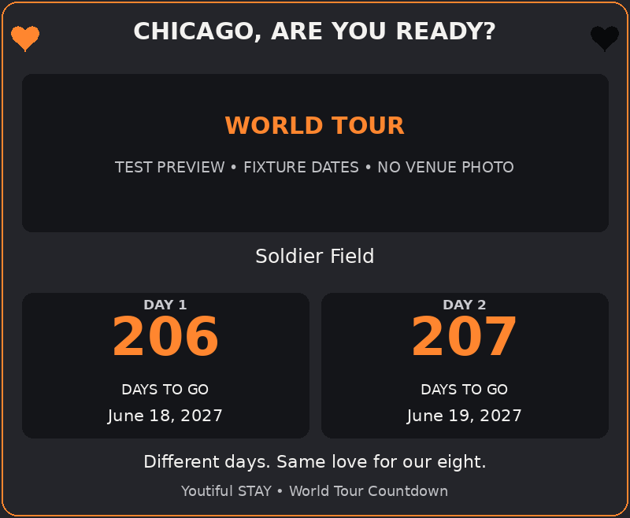
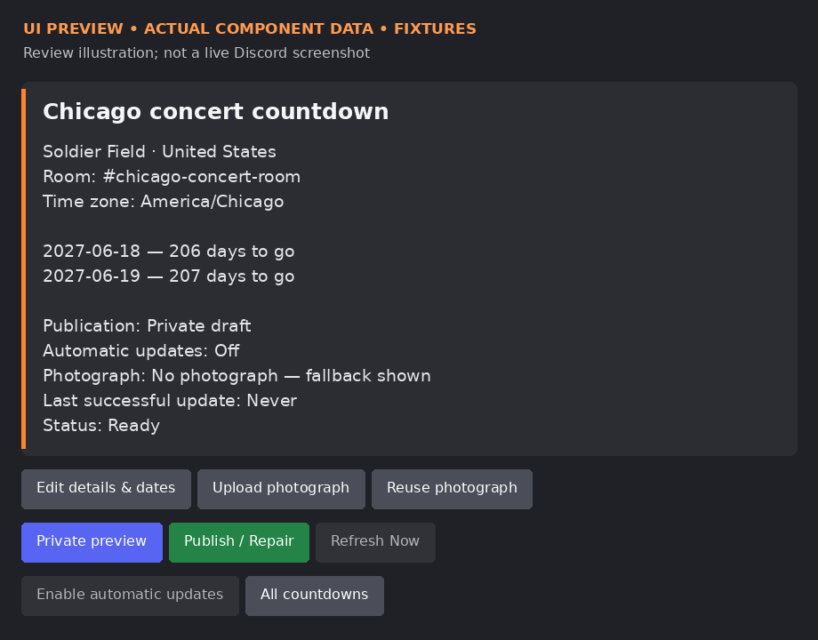

# Concert Countdown Manager — PR #324 review report

Source: [PR #324](https://github.com/StrayMoon03/Harmony/pull/324), continuing `feature/concert-countdown` from `ac00bf067697e911df86234aa03ee466cda45623`. The final commit SHA is supplied with the implementation handoff. **Do not merge or deploy before Q and owner approval.**

## Completed behavior

The private Control Center now opens a graphical Concert Countdown Manager. Administrators can select an existing room, search and select approved concerts, edit venue details, upload or reuse a photograph, preview privately, approve publication, toggle automatic updates, refresh, and repair a missing message. Newly approved dates can be added through the same event picker. No event or channel IDs need to be typed. Sessions are private to their administrator and reject expired sessions and replaced Control Center panels. Conflicting configuration edits require reopening the saved configuration.

Countdowns read stable event IDs from Harmony's existing approved `scheduled_events` calendar. Radar and Calendar Review candidates remain separate and cannot appear in the picker. Reschedules and cancellations are read on the next update. Timed concerts are converted to the configured venue's local date; all-day concerts retain their calendar date. Each date independently displays days remaining, TOMORROW!, IT'S D-DAY, STAY!, or THANK YOU FOR THE MEMORIES!. Numbers never become negative.

The deterministic PNG renderer preserves the charcoal/orange card, orange and black hearts, venue panorama, large numbers, full dates, and approved footer wording. Single panels are centered, paired panels are balanced, and an odd final panel is centered. Accessible text is included in the Discord message and attachment description.

Publication requires an explicit approval button (or the optional advanced publish command). Each room has one managed message ID. Images replace old attachments. A durable delivery intent is saved before sending; recovery searches the complete recorded history interval, including unpinned messages beyond the latest 100. Message IDs persist before pinning, so failed pins do not cause a second send. Recovery understands the preliminary implementation's marker. SQLite leases, heartbeat renewal and in-process locks prevent overlapping operations.

Automatic checks run at startup and every minute for enabled countdowns. Unchanged countdowns make no Discord requests until a six-hour health check; changes after local midnight or calendar edits trigger an update. Deleted or unpinned messages are repaired at the next update/health check, or immediately with Publish / Repair. Discord.js manages normal REST rate limits; surfaced failures save an error and retry delay.

## Actual renderer output

**These are labeled test previews, using fixture dates and no venue photograph.** The production calendar and an administrator-approved Soldier Field photograph were not available. Dates and numbers in these files are not confirmation of real concert dates. Production dates are selected from the existing approved calendar at activation.

- [Chicago two-date PNG](countdown-previews/chicago-two-dates.png)
- [Single-date PNG](countdown-previews/single-date.png)
- [Three-date PNG](countdown-previews/multiple-dates.png)
- [Completed, D-day and tomorrow states](countdown-previews/concert-day-states.png)



## Manager UI previews

These are clearly labeled review illustrations generated from the **actual Discord component payloads**, not screenshots from a live Discord client. Component builders and the file-upload modal were validated against installed Discord.js **14.27.0**.

- [Manager home](countdown-previews/manager-home.png)
- [Countdown controls and status](countdown-previews/manager-details.png)
- [Venue configuration](countdown-previews/manager-setup.png)
- [Approved-event picker](countdown-previews/manager-events.png)
- [Underlying component payloads](countdown-previews/manager-payloads.json)



## Verification

| Check | Result |
| --- | --- |
| Countdown tests | 45 passed; 0 failed; 0 skipped |
| Complete Harmony regression suite | 890 passed; 0 failed; 0 skipped |
| Existing Schedule Manager tests with fixture clocks corrected | 131 passed; 0 failed |
| PNG generation | Actual Pillow output, decoded and inspected |
| Image input validation | JPEG/PNG decoding, malformed/truncated data, unsupported formats, file limits and pixel limits tested |
| Discord behavior | Publication, pinning, updates, replacement attachments, deleted-message repair, lost send responses, restarts, concurrency, database leases, retries, permissions and startup scheduling tested with API doubles |
| Administration | Room/event selection, new approved dates, canceled-date replacement, scoped authorization, stale sessions, persistence, upload/replacement, private previews and explicit publication tested |
| Existing features | Entire existing suite exercised, including Radar, Calendar Review, scheduling, Welcome Pass, member counts and other Control Center tools |
| Diff and syntax checks | Passed |

[Complete executed test results](countdown-previews/test-results.txt).

Commands:

```sh
node --test test/concertCountdown*.test.js
HARMONY_DB_PATH="$(mktemp -d)/suite.sqlite" npm test -- --test-concurrency=1
node scripts/generate-countdown-previews.cjs
python3 scripts/render-countdown-manager-previews.py
```

The complete suite runs sequentially because existing test files share a default SQLite database. Two pre-existing Schedule Manager failures were reproduced on unchanged `main`: early-November fixtures depended on the current date. Their tests now use scoped fixture clocks; production scheduling code was not changed. The Control Center assertions now include its ninth button.

All four countdown PNGs and the manager previews were inspected. Self-review corrected completed-state word wrapping, canceled-event editing, acknowledgement of slow room lookups, preservation of controls after errors, legacy unpinned-message recovery, and bulk photograph loading during scheduler scans.

## Photography and runtime

JPEG and PNG uploads are accepted through a Discord file-upload modal, decoded in a separate Python process, stripped of metadata through JPEG normalization and saved in SQLite. Photographs can be reused within the same server. Limits: 4 MB input, 16 megapixels, 8192 pixels per side, 15-second worker timeout, 10-second CPU limit, 512 MB address-space limit and eight queued jobs. Scheduled rendering is fully offline and never searches for or downloads photographs. Missing photographs use the built-in fallback.

The preliminary Python Playwright renderer was replaced with Pillow to avoid a browser process for each card. The Dockerfile includes pinned `Pillow==13.0.0` and `fonts-dejavu-core`. Rendering and validation ran with that Pillow version, Node 24.22.3, and the installed font files. No npm runtime dependency was added. A Docker daemon was unavailable, so a complete Docker image build remains unverified.

Keep `HARMONY_DB_PATH` on the existing persistent volume and include it in normal backups: countdown configuration, images, message IDs, errors and recovery state are stored there. The additive migration is repeatable and tested against the preliminary schema. After a process crash, an outstanding update lease may take up to 15 minutes to expire. Recovery stops safely rather than posting if more than 10,000 messages must be inspected; this unusual case needs administrator assistance.

## Permissions and activation

Harmony needs **View Channel, Read Message History, Send Messages, Attach Files and Pin Messages** in each selected concert room. Management uses the existing server-owner/Manage Server/Administrator authorization policy and the active private Control Center. No room permission changes are performed by this feature.

After deployment is separately approved:

1. Open **Control Center → Concert Countdowns → Add countdown** and choose the existing Chicago room.
2. Select Chicago's confirmed approved calendar events. Enter Chicago, United States, Soldier Field and `America/Chicago`; existing location/time-zone metadata is filled where available.
3. Save the configuration. Upload an authorized Soldier Field photograph and inspect **Private preview**.
4. Choose **Publish / Repair → Approve & publish**, then **Enable automatic updates**.
5. Repeat for additional rooms. To associate a new approved date, open that room's countdown and use **Edit details & dates → Select concert dates**.

Pinning makes the countdown available through Discord's pinned messages interface. It does not keep it at the top of the conversation.

## Remaining live verification

The database, calculations, image processor, component payloads and automated behavior are verified locally. Discord publication/pinning/attachment replacement, actual client presentation of the file-upload modal, and recovery against Discord's live API still need a separately authorized pilot. No live rooms were modified; nothing was published, merged or deployed. Production Chicago dates and an approved venue photograph must be selected before activation.
